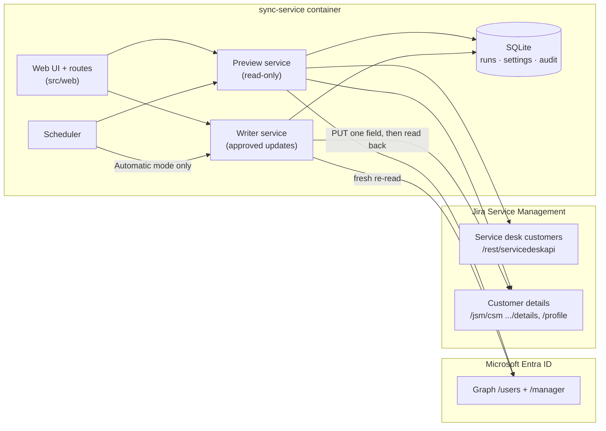

# Architecture

Entra to Jira Customer Sync is a single Node.js service (TypeScript, Fastify, SQLite) that keeps five detail fields on **existing** Jira Service Management customers in step with Microsoft Entra ID.

## Data flow

## Run lifecycle

1. **Preview** (`ProductionSyncPreviewService`, read-only)
   - Enumerates every customer of the configured service desks (`JSM_SERVICE_DESK_IDS`), paging until Jira reports the last page and de-duplicating by account ID.
   - Skips customers whose email domain is not approved (`DOMAIN_NOT_APPROVED`), who are inactive, or whose email is hidden.
   - Matches each remaining customer to exactly one Entra user by normalized email (`ENTRA_NOT_FOUND` / `ENTRA_AMBIGUOUS` otherwise).
   - Reads the customer's Jira profile and plans changes with the `DiffPlanner`. Empty directory values never replace populated Jira values; phone formatting, email case, and whitespace are compared semantically.
   - Stores the plan encrypted, with a SHA-256 **approval code** over the scope, approved domains, and every planned change.
2. **Approve** (web route `/runs/approve`)
   - Requires Manual approval or Automatic mode, **Allow updates to Jira**, no pause, no other active run, and the exact 64-character approval code.
3. **Update** (`ProductionSyncWriterService`)
   - Re-checks the digest, scope, approved domains, single use of the preview, and the safety limits.
   - For each customer, re-reads Entra and Jira and recomputes the plan. Any difference stops the run (drift).
   - Writes one field at a time with pacing, using the field name discovered on that Jira site, and reads the profile back to confirm it.
   - Stops on the first rejection, mismatch, unknown outcome (no answer), or failed confirmation. Records every customer as Verified, Partial, Failed, or Not attempted.
4. **Schedule** (`SchedulerService`)
   - Runs one preview per configured window (daily, weekdays, weekly, monthly; DST-safe, no duplicates).
   - In Automatic mode it also applies that preview's changes, linked to the preview.

## Safety mechanisms

| Mechanism                     | Where                                                                                                                          |
| :---------------------------- | :----------------------------------------------------------------------------------------------------------------------------- |
| No customer creation/deletion | Only the customer-detail `PUT` exists (`customer-detail-write-client.ts`); all other Jira calls go through the GET-only client |
| Non-erasure                   | `DiffPlanner`                                                                                                                  |
| Approval code binding         | `computePreviewDigest` and writer preflight                                                                                    |
| Drift detection               | Writer re-reads Entra and Jira per customer                                                                                    |
| Safety limits                 | Settings (default 100 customers / 400 details)                                                                                 |
| Single active run             | `active_lock` table with PID-aware crash recovery                                                                              |
| Request ceilings              | A fresh `RequestBudgetGuard` per run; exceeding it fails closed                                                                |
| Timeouts                      | 30 s per Jira request; an unanswered write is "outcome unknown" and never retried                                              |
| Emergency pause               | Checked before each run and before every write                                                                                 |
| Graceful shutdown             | New runs refused, in-flight runs stop at the next safe point, bounded wait before storage closes                               |
| Restart recovery              | Unfinished runs are marked Interrupted and never replayed                                                                      |

## Security

- Local administrator accounts with scrypt password hashes (cost stored in the hash), forced first-use password change, rate-limited sign-in, 8-hour sessions with a 30-minute idle timeout.
- CSRF tokens and Origin checks on every form; strict Content Security Policy with no inline script or style; HSTS on HTTPS.
- `X-Forwarded-*` headers are honored only from proxies listed in `WEB_TRUST_PROXY`.
- Atlassian OAuth 2.0 (3LO): state bound to the session and used once; rotating refresh tokens persisted atomically under `secrets/`.
- Customer emails and run details encrypted at rest with AES-256-GCM (`secrets/encryption.key`); SMTP password encrypted with the same key.
- Logs, alerts, and error pages never contain tokens, secrets, field values, or full email addresses.

## Code layout

| Path                    | Contents                                                                              |
| :---------------------- | :------------------------------------------------------------------------------------ |
| `src/web/app.ts`        | Fastify setup, security headers, sessions, rendering, error pages, shutdown           |
| `src/web/routes/`       | Route modules: auth, overview, runs, schedule, settings, connections, system          |
| `src/web/wiring.ts`     | Builds services and per-run Jira clients                                              |
| `src/web/store.ts`      | SQLite schema, migrations, settings, runs, audit, alerts                              |
| `src/services/`         | Preview, writer, scheduler, notifications, SMTP client, diff planner                  |
| `src/connectors/jira/`  | OAuth, GET-only HTTP client, customer scope reader, CSM target, field catalog, writer |
| `src/connectors/entra/` | Microsoft Graph client and directory source                                           |
| `src/config/`           | Environment helpers and the CLI configuration                                         |
| `src/index.ts`          | CLI diagnostics entry point (see [CLI docs](cli/README.md))                           |

## Appendix: CLI diagnostics

The CLI (`npm run cli`) predates the web interface. It offers read-only diagnostics (field discovery, enumeration validation, single-customer validation, end-to-end dry runs) and two tightly bounded legacy write paths. It uses its own environment flags (section 7 of `.env.example`), and no web route can reach it. See [docs/cli/README.md](cli/README.md).
